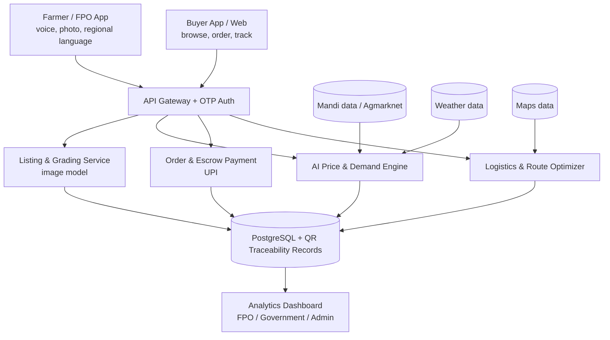

# Date: 25/11/2026

## Reference Number: 26002593

## Name: prathiksha.s

## Problem Title
SIH 26033: Multiple intermediaries reduce farmers earnings and increase consumer prices.

## Problem Creater's Organization
Ministry of Consumer Affairs, Food & Public Distribution

## Theme
Agriculture, FoodTech & Rural Development

## Problem Description
**Expected Solution:** Create a digital marketplace that:
- Connects farmers/FPOs directly with consumers and bulk buyers.
- Provides logistics support.
- Uses AI for demand forecasting and route optimization.

**Benefits:**
- Better prices for farmers.
- Lower prices for consumers.
- Reduced supply chain inefficiencies.

---

## Proposed Solution

**Project name: HarvestHub, a demand-driven direct farm-to-buyer marketplace**

HarvestHub is a mobile and web platform that connects farmers and Farmer Producer Organisations (FPOs) directly with consumers, retailers, restaurants and bulk buyers. It replaces the multi-layer chain of village agent, commission agent, wholesaler and retailer with one transparent digital channel.

### 1. Detailed explanation of the proposed solution

a) Farmer/FPO module
- OTP login; list produce by voice or photo in regional languages (Tamil, Hindi, Telugu, etc.).
- Each listing has crop, quantity, expected harvest date, location and quality grade.
- FPOs manage many farmers from one account and aggregate small lots into bulk supply.

b) Buyer module
- Households, restaurants, retailers and institutions browse, filter by crop, location and grade, and order or pre-book.
- Bulk buyers post demand requests (e.g. "5 tonnes of tomatoes weekly") and nearby FPOs respond.

c) AI engine
- **Demand forecasting:** predicts regional demand from past orders, seasonality, festivals and weather.
- **Fair-price suggestion:** gives a price range from mandi prices, supply and demand.
- **Produce grading:** an image-based model assigns a quality grade.

d) Logistics module
- Local collection hubs gather produce from nearby farmers.
- A route optimizer pools orders into shared delivery runs, cutting cost per kg and spoilage.
- Buyers track orders from pickup to delivery.

e) Payments and trust module
- UPI payment held in escrow and released to the farmer's bank account on delivery confirmation.
- QR code on each lot shows farm, farmer, harvest date and price breakup.

### 2. How it addresses the problem

| S.No | Problem in the current system | How HarvestHub solves it | Result |
|---|---|---|---|
| 1 | Many intermediaries take a margin at every stage | Direct farmer/FPO-to-buyer sale; only a small platform and logistics fee remains | Farmer keeps a larger share of the price |
| 2 | Farmers lack price information and accept low offers | AI fair-price indicator using mandi data, supply and demand | Farmers sell with confidence |
| 3 | Consumers pay inflated prices | Fewer layers and pooled transport lower the added cost | Lower prices for consumers |
| 4 | Unsold produce and distress selling | Demand forecasting and pre-harvest booking give a committed buyer | Less wastage, more stable income |
| 5 | High transport cost and spoilage | Hub-based collection and AI route optimization | Lower logistics cost, fresher produce |
| 6 | Delayed or unsafe payments | UPI escrow, released on delivery | Fast, secure payment |
| 7 | No transparency on who earns what | Price breakup shown on every order (farmer share, transport, platform fee, tax) | Trust for farmers and buyers |
| 8 | Small farmers cannot reach bulk buyers | FPO hubs aggregate small lots into bulk supply | Better market access |

### 3. Innovation and uniqueness of the solution
- **Pre-harvest booking:** buyers commit to upcoming harvests, giving farmers price certainty.
- **Demand-driven selling:** tells farmers what is in demand and when, not just a listing board.
- **Transparent price breakup** on every order.
- **Hub-and-spoke FPO model** so small farmers reach bulk buyers without their own transport.
- **Voice-first, multilingual interface** for low-literacy users.
- **Built-in logistics:** pickup, pooling and delivery are part of the platform.
- **QR traceability** so consumers can see the source of what they buy.

---

## Technical Approach

### 1. Technologies to be used

| Layer | Technology |
|---|---|
| Frontend | Flutter or React Native (mobile), React (web) |
| Backend | Python FastAPI or Node.js, REST APIs |
| Database | PostgreSQL, Redis for caching |
| AI/ML | Python, scikit-learn, XGBoost or Prophet (demand forecasting), TensorFlow Lite (produce grading) |
| Route optimization | Google OR-Tools with Maps API |
| Payments | UPI / Razorpay with escrow flow |
| Voice and language | Speech-to-text and translation APIs (e.g. Bhashini) |
| Data sources | Agmarknet, data.gov.in, weather APIs |
| Hosting | Cloud (AWS / GCP / Azure) |

### 2. Methodology and process for implementation

**System architecture**



**Process flow**

```mermaid
flowchart LR
    A[Farmer registers and lists produce] --> B[AI grades quality]
    B --> C[Fair-price range suggested]
    C --> D[Buyer orders or pre-books]
    D --> E[Payment held in escrow]
    E --> F[Orders pooled and route planned]
    F --> G[Pickup from hub and delivery]
    G --> H[Buyer confirms, QR scanned]
    H --> I[Payment released to farmer]
```



**Steps**
1. Farmer/FPO registers (OTP login) and lists produce.
2. Grading model checks the photo and assigns a quality grade.
3. Price engine suggests a fair price range.
4. Demand model forecasts regional demand so the farmer knows what to sell and when.
5. Buyer places an order or pre-booking; payment is held in escrow.
6. Route optimizer pools orders and plans collection and delivery.
7. Buyer scans the QR code; payment is released to the farmer on delivery.

---

## Feasibility and Viability

### 1. Analysis of the feasibility of the idea
- **Technical:** all components use mature open-source tools and public APIs.
- **Operational:** FPOs already aggregate farmers, so hubs can build on existing structures.
- **Economic:** revenue from a small platform fee (about 2-4%) and logistics charges, well below typical middlemen margins.
- **Scalability:** start with a few crops in one district, then expand.

### 2. Potential challenges and risks
- Low digital literacy among farmers
- Buyer trust and consistent produce quality
- Perishability and last-mile logistics cost
- Initial adoption by farmers and buyers
- Price data gaps in some regions

### 3. Strategies for overcoming these challenges

| Challenge | Strategy |
|---|---|
| Low digital literacy | Voice UI, regional languages, FPO field agents |
| Quality and trust | AI grading, QR traceability, ratings, escrow |
| Logistics cost | Route pooling, local hubs, scheduled pickups |
| Adoption | Pilot with FPOs, bulk buyers first, assured pre-harvest orders |
| Data gaps | Combine mandi data with crowdsourced price reports |

---

## Impact and Benefits

### 1. Potential impact on the target audience
- **Farmers/FPOs:** higher income by capturing a larger share of the final price (expected improvement, not a guarantee).
- **Consumers:** fresher produce at lower or more stable prices.
- **Bulk buyers:** reliable supply with quality grading.
- **Government/Ministry:** real-time data on supply, demand and prices for policy decisions.

### 2. Benefits of the solution
- **Social:** empowers small farmers and FPOs; inclusive voice-based UI for rural users.
- **Economic:** fewer intermediaries, fairer price discovery, less price volatility.
- **Environmental:** less food spoilage and fewer transport kilometres through pooled routes.

---

## Research and References

- Agmarknet (mandi price data): https://agmarknet.gov.in
- e-NAM, National Agriculture Market: https://enam.gov.in
- Open Government Data Platform India: https://data.gov.in
- ONDC, Open Network for Digital Commerce: https://ondc.org
- Bhashini, Indian language AI platform: https://bhashini.gov.in
- Google OR-Tools documentation: https://developers.google.com/optimization
````

